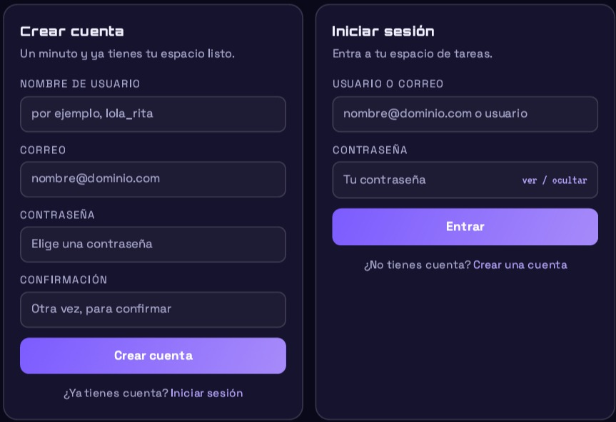
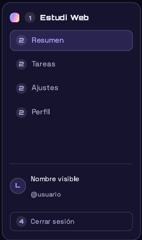
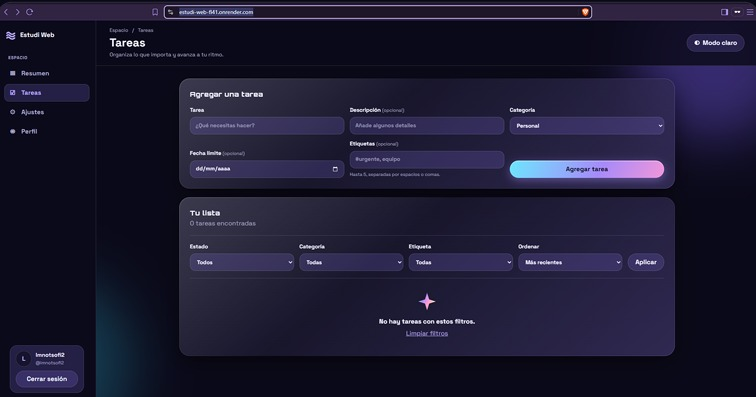
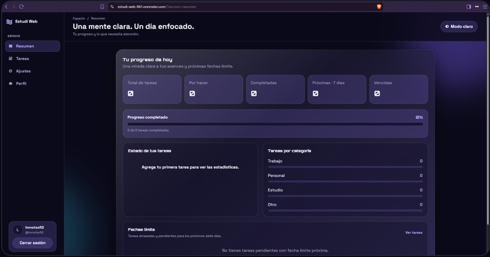
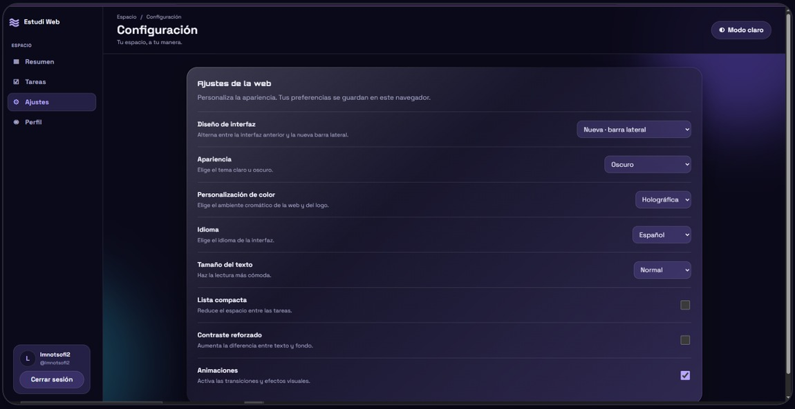
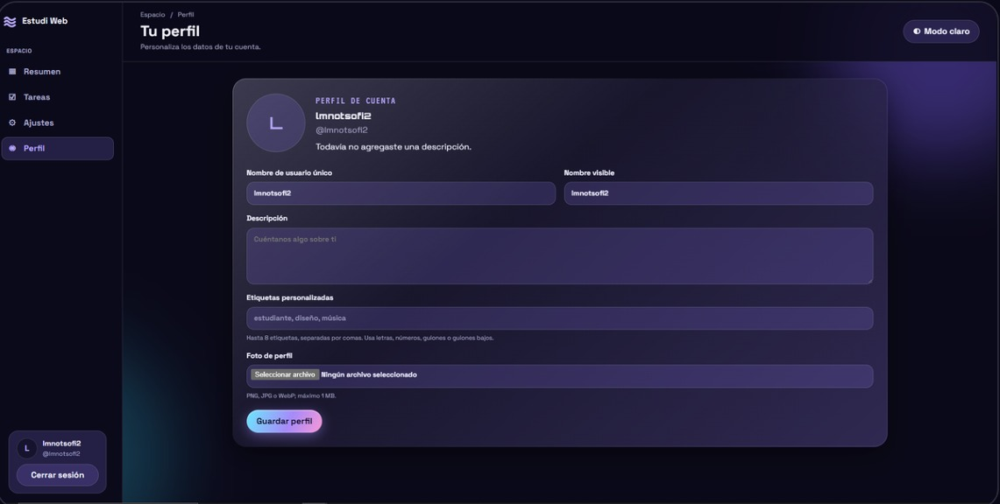

# 📖 GUÍA DE USUARIO SECCIÓN POR SECCIÓN: Estudi Web

> **Tu día, más claro. Tus pendientes, en orden.**
> Esta guía explica, paso a paso, qué hace cada parte de la web de Estudi y cómo sacarle partido: crear y organizar tareas, leer tu progreso en el Resumen, adaptar la apariencia en Ajustes y personalizar tus datos en el Perfil.

También puedes consultar o descargar el [manual de usuario en PDF](./docs/GUIA_DE_USUARIO.pdf).

---

## 📑 Contenido
1. [¿Qué es Estudi Web?](#1-qué-es-estudi-web)
2. [Acceso y cuenta](#2-acceso-y-cuenta)
3. [La interfaz, de un vistazo](#3-la-interfaz-de-un-vistazo)
4. [Tareas: crea y organiza](#4-tareas-crea-y-organiza)
5. [Resumen: tu progreso](#5-resumen-tu-progress)
6. [Ajustes: la web a tu manera](#6-ajustes-la-web-a-tu-manera)
7. [Perfil: tus datos](#7-perfil-tus-datos)
8. [Preguntas frecuentes](#8-preguntas-frecuentes)

---

## 01. ¿Qué es Estudi Web?
Estudi Web es una aplicación web ligera para organizar tareas personales con categorías, etiquetas y filtros. Su lema resume bien la filosofía: **menos ruido, más foco y todo en su lugar.**

* **Tarea:** El pendiente básico: título, descripción opcional y estado.
* **Categoría:** Cada tarea pertenece a una de cuatro: *Trabajo, Personal, Estudio u Otro*.
* **Etiqueta:** Palabras clave que empiezan con `#` (hasta cinco por tarea).
* **Fecha límite:** El día en que la tarea debería estar lista.
* **Filtro:** Combinación de estado, categoría y etiqueta para mostrar solo lo importante.
* **Aviso:** Banda verde o rosa de confirmación tras cada acción.

---

## 02. Acceso y cuenta
La primera vez que abres la web debes iniciar sesión o crear una cuenta nueva.

* **Crear cuenta:** Elige un nombre de usuario único (3 a 24 caracteres), un correo válido y una contraseña segura de al menos 8 caracteres.
* **Iniciar sesión:** Puedes entrar usando tu correo o tu nombre de usuario junto con tu contraseña.
* **Cerrar sesión:** Ubicado en la tarjeta inferior de la barra lateral, borra la sesión de este navegador sin tocar tus datos en la nube.

---

## 03. La interfaz, de un vistazo
Todo ocurre dentro de una única página con una barra lateral fija a la izquierda:

* **Marca:** Logo y enlace directo al Resumen.
* **Menú principal:** Resumen, Tareas, Ajustes y Perfil.
* **Tarjeta de cuenta:** Muestra tu avatar, nombre visible y usuario.
* **Botón Modo claro:** Permite alternar el tema visual desde cualquier sección.

---

## 04. Tareas: crea y organiza
El taller de la aplicación reúne el formulario **Agregar una tarea** y **Tu lista** con filtros avanzados.

* **Campos:** Título (obligatorio), Descripción, Categoría, Fecha límite y Etiquetas (hasta 5).
* **Filtrado y Orden:** Permite ordenar por más recientes, más antiguas o por título alfabético.
* **Acciones:** Marca casillas para completar al instante o elimina con confirmación previa.
* **Seguridad:** El servidor valida los datos y el texto que contiene etiquetas HTML se muestra como texto, sin ejecutarse como código.

---

## 05. Resumen: tu progreso
El panel de control calcula en tiempo real métricas clave:

* **Tarjetas:** Total de tareas, Por hacer, Completadas, Próximas 7 días y Vencidas.
* **Gráficos:** Dona de estado y barras de distribución por categoría (*Trabajo, Personal, Estudio, Otro*).

---

## 06. Ajustes: la web a tu manera

Reúne 8 preferencias guardadas en el navegador actual:
* **Diseño de interfaz:** Barra lateral o navegación superior.
* **Apariencia y Colores:** Tema Oscuro/Claro/AMOLED y paletas cromáticas (*Holográfica, Océano, Atardecer, etc.*).
* **Idioma:** Español, English, Português, 中文, 日本語, 한국어.

---

## 07. Perfil: tus datos

Permite personalizar tu identidad visible en la app:
* **Campos editables:** Nombre de usuario único, Nombre visible, Descripción (hasta 280 caracteres), Etiquetas personalizadas y Foto de perfil (PNG/JPG/WebP, máx. 1 MB).

---

## 08. Preguntas frecuentes
* **¿Dónde se guardan mis tareas?** En la nube, asociadas a tu cuenta.
* **¿Mis tareas son privadas?** Sí, cada cuenta accede únicamente a su propia información.
* **¿Funciona en el móvil?** Sí, la interfaz se adapta por completo a pantallas estrechas.
* **¿Qué pasa si escribo etiquetas HTML en una tarea?** Se muestran como texto y no se ejecutan en el navegador.
