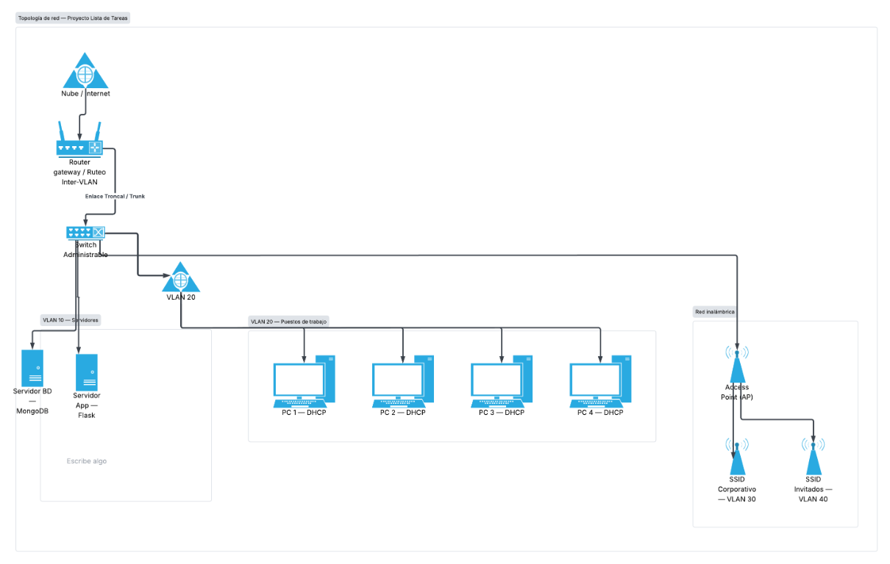

# REDES

## Diagrama de topología

## Diseño y justificación

La red está pensada para una PyME de desarrollo de software y consultoría que despliega la aplicación Lista de Tareas. Utiliza una topología de estrella extendida con segmentación lógica por VLAN.

La topología centraliza las conexiones en el router y el switch administrable, facilita la gestión del tráfico y permite aislar fallas de los puestos finales. También permite sumar puestos sin modificar la estructura principal. El router realiza el enrutamiento entre VLAN y brinda salida a Internet; el switch se conecta al router mediante un enlace troncal.

## Componentes y segmentos

- **VLAN 10 – Servidores:** contiene el servidor de aplicación Flask y el servidor de base de datos MongoDB. Se reservan direcciones estáticas para estos equipos.
- **VLAN 20 – PCs cableadas:** conecta los puestos de trabajo por Ethernet. Las direcciones se asignan dinámicamente mediante DHCP.
- **VLAN 30 – Wi-Fi Staff:** corresponde al SSID corporativo del punto de acceso. Las direcciones se asignan mediante DHCP.
- **VLAN 40 – Wi-Fi Invitados:** corresponde al SSID para invitados, separado del tráfico corporativo. Las direcciones se asignan mediante DHCP.

El punto de acceso se conecta al switch y separa las redes inalámbricas corporativa y de invitados en sus respectivas VLAN.

## Tabla de direccionamiento

| VLAN (ID y nombre) | Red / Prefijo | Máscara | Rango de hosts | Gateway | Hosts útiles |
|---|---|---|---|---|---:|
| VLAN 10 – Servidores | 192.168.10.0/24 | 255.255.255.0 | 192.168.10.2–192.168.10.50 (estáticas) | 192.168.10.1 | 254 |
| VLAN 20 – PCs cableadas | 192.168.20.0/24 | 255.255.255.0 | 192.168.20.2–192.168.20.254 (DHCP) | 192.168.20.1 | 254 |
| VLAN 30 – Wi-Fi Staff | 192.168.30.0/24 | 255.255.255.0 | 192.168.30.2–192.168.30.254 (DHCP) | 192.168.30.1 | 254 |
| VLAN 40 – Wi-Fi Invitados | 192.168.40.0/24 | 255.255.255.0 | 192.168.40.2–192.168.40.254 (DHCP) | 192.168.40.1 | 254 |

Las subredes utilizan direcciones privadas del bloque 192.168.0.0/16, dividido en redes /24. Cada /24 ofrece 254 direcciones de host utilizables; el conteo incluye la dirección del gateway (.1). Los rangos de la tabla indican las direcciones asignables a los dispositivos, excluyendo el gateway. En la VLAN 10 se reserva el rango .2–.50 para direcciones estáticas de servidores.
