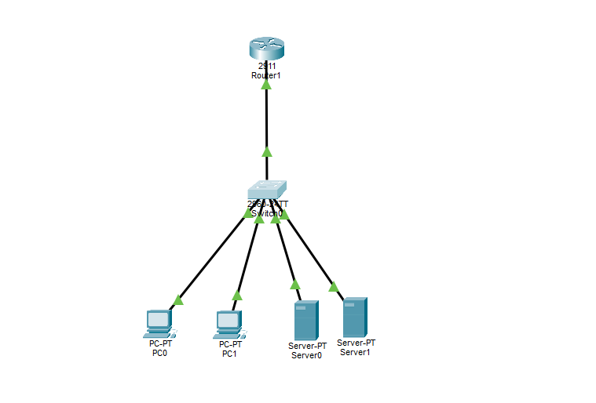
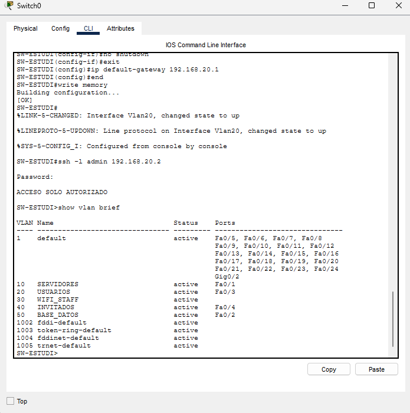
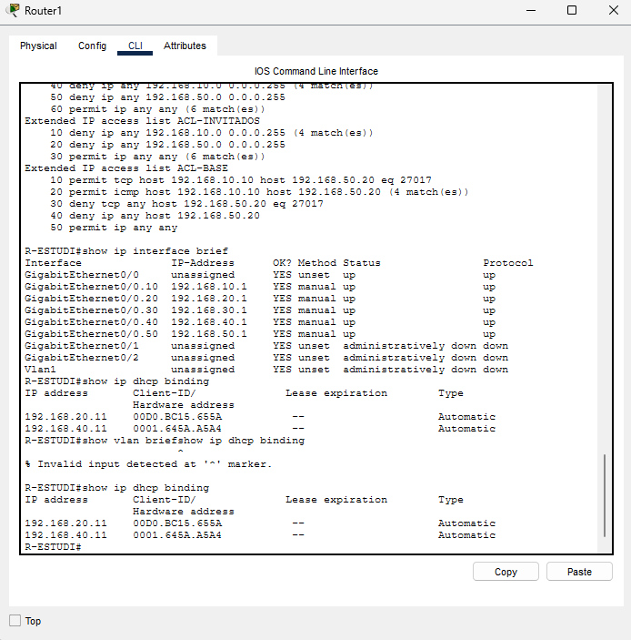
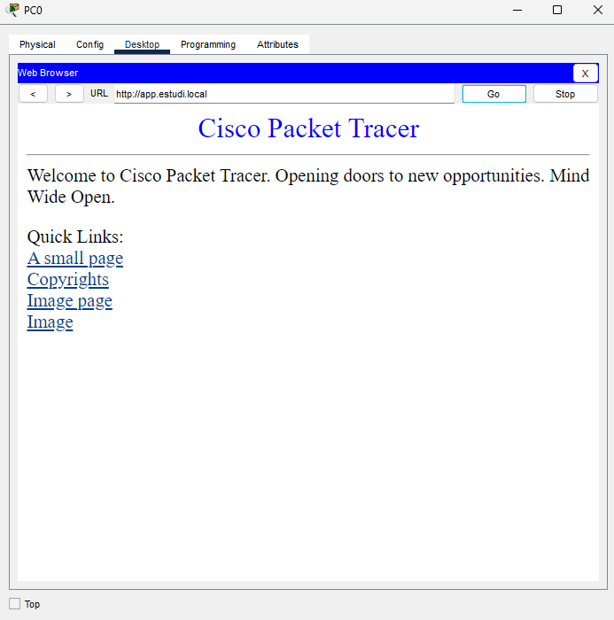
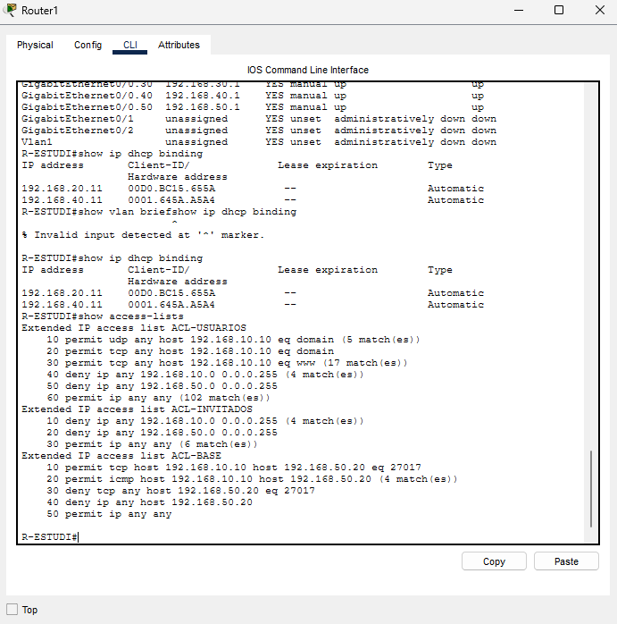
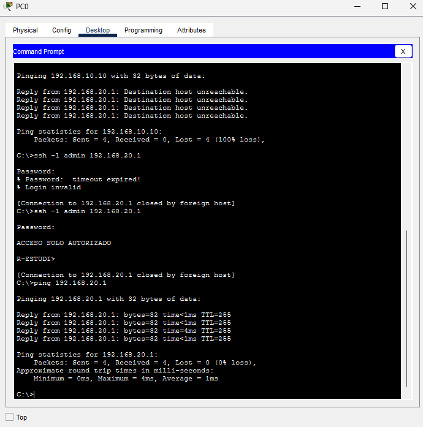
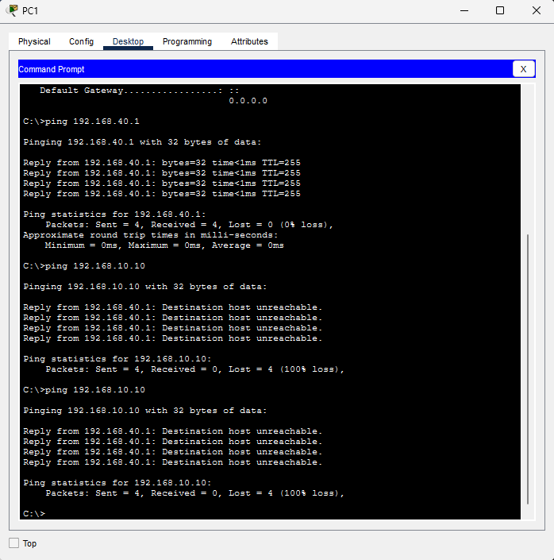

# Documentación de redes — Estudi Web

## A. Introducción

Esta simulación académica representa una red segmentada para alojar servicios relacionados con Estudi Web y controlar el acceso entre los distintos grupos de equipos. La aplicación del repositorio es una aplicación Flask que usa MongoDB; los dispositivos de Packet Tracer ilustran servicios de red y no ejecutan esa aplicación ni una instancia real de MongoDB.

La topología se creó en **Cisco Packet Tracer**. El archivo editable está en la raíz del repositorio: [EstudiWeb_Redes.pkt](./EstudiWeb_Redes.pkt).

### Organización y escenario

El escenario es un laboratorio académico para un equipo que desarrolla y prueba Estudi Web. La red separa los servidores de aplicación y de datos, los puestos de usuarios y la red prevista para invitados; el router proporciona gateways y filtra tráfico entre segmentos. No representa una instalación productiva ni una conexión real entre la red simulada y MongoDB Atlas.

## B. Topología

La topología física es una estrella: un router Cisco 2911 enlazado con un switch Cisco 2960, dos equipos PC-PT y dos servidores Server-PT. La lista de dispositivos y enlaces del archivo confirma estos enlaces de cobre directos, todos con estado verde:

| Extremo | Puerto en el switch | Función observada |
|---|---|---|
| `Server0:FastEthernet0` | `Switch0:FastEthernet0/1` | Servidor de aplicación, IP `192.168.10.10`. |
| `Server1:FastEthernet0` | `Switch0:FastEthernet0/2` | Servidor que representa la base de datos. |
| `PC0:FastEthernet0` | `Switch0:FastEthernet0/3` | Cliente de Usuarios. |
| `PC1:FastEthernet0` | `Switch0:FastEthernet0/4` | Cliente de Invitados. |
| `Router1:GigabitEthernet0/0` | `Switch0:GigabitEthernet0/1` | Enlace troncal entre router y switch. |

Las etiquetas visibles son `Router1`, `Switch0`, `PC0`, `PC1`, `Server0` y `Server1`.



| Dispositivo | Función en la simulación | Evidencia y límites |
|---|---|---|
| Cisco 2911 | Gateway y enrutamiento entre VLAN mediante subinterfaces de GigabitEthernet0/0. | `show ip interface brief` muestra las subinterfaces `.10` a `.50` con direcciones `.1`, activas. |
| Cisco 2960 | Switching de acceso y pertenencia de puertos a VLAN. | `show vlan brief` y `show interfaces trunk` se comprobaron en el archivo: GigabitEthernet0/1 opera como trunk 802.1Q. |
| PC0 y PC1 | Clientes de prueba de las redes Usuarios e Invitados. | El cableado y las VLAN asignadas a Fa0/3 y Fa0/4 se corroboran en el archivo. |
| Server0 y Server1 | Servidores Packet Tracer para representar los servicios de aplicación y base de datos. | Se verificó `Server0` en `192.168.10.10`; las ACL identifican `192.168.50.20` como destino de base de datos. |

La topología no contiene un punto de acceso. Aunque existe una VLAN denominada `WIFI_STAFF`, en el archivo guardado no tiene puertos de acceso asignados ni aparece un pool DHCP para ella; por lo tanto, no se documenta una red Wi-Fi funcional.

## C. Plan de direccionamiento IP

La tabla de interfaces del router muestra las puertas de enlace `.1` en las cinco subinterfaces. Las máscaras `/24` se deducen de las redes y las wildcard `0.0.0.255` mostradas en las ACL. Las dos IP de servidor de la tabla son los hosts a los que apuntan las reglas de acceso; no se dispone de una captura de la configuración IP estática en los servidores.

| VLAN | Nombre mostrado | Red / máscara | Gateway del router | Hosts identificados en la evidencia |
|---:|---|---|---|---|
| 10 | `SERVIDORES` | `192.168.10.0/24` (`255.255.255.0`) | `192.168.10.1` | `Server0`: `192.168.10.10` estática, observada en la configuración del dispositivo. |
| 20 | `USUARIOS` | `192.168.20.0/24` (`255.255.255.0`) | `192.168.20.1` | Pool DHCP `USUARIOS`; concesión `192.168.20.11`. |
| 30 | `WIFI_STAFF` | `192.168.30.0/24` (`255.255.255.0`) | `192.168.30.1` | La subinterfaz existe, pero el VLAN no tiene puertos asignados ni pool DHCP en el archivo actual. |
| 40 | `INVITADOS` | `192.168.40.0/24` (`255.255.255.0`) | `192.168.40.1` | Pool DHCP `INVITADOS`; concesión `192.168.40.11`. |
| 50 | `BASE_DATOS` | `192.168.50.0/24` (`255.255.255.0`) | `192.168.50.1` | `192.168.50.20` es el destino de las ACL; revisar la IP directamente en `Server1` antes de presentarla como verificada. |

**Alcance de la VLAN 50:** no pertenecía a las cuatro VLAN del diseño inicial (10, 20, 30 y 40). Se incluye aquí porque `show vlan brief`, la subinterfaz `GigabitEthernet0/0.50` y las ACL muestran que `BASE_DATOS` sí está implementada en esta simulación.

Las cinco subredes de la simulación usan máscara `/24`; el archivo no implementa VLSM. Si la rúbrica exige subnetting de longitud variable, será necesario rediseñar el plan de direccionamiento y reconfigurar las interfaces, pools y ACL antes de afirmar que ese requisito está cumplido.

## D. Configuración de VLAN y switching

La consulta `show vlan brief` del archivo guardado confirma estas VLAN y asignaciones:

| VLAN | Nombre | Puerto de acceso mostrado |
|---:|---|---|
| 10 | `SERVIDORES` | `Fa0/1` |
| 20 | `USUARIOS` | `Fa0/3` |
| 30 | `WIFI_STAFF` | Sin puertos asignados |
| 40 | `INVITADOS` | `Fa0/4` |
| 50 | `BASE_DATOS` | `Fa0/2` |



**Diferencia entre evidencia y archivo:** la imagen `02-vlans.png` muestra Fa0/5 en VLAN 30, mientras que al abrir el `.pkt` y ejecutar `show vlan brief`, VLAN 30 aparece sin puertos y Fa0/5 permanece en VLAN 1. Para describir la simulación entregada prevalece el estado del `.pkt`; hay que corregir la simulación o volver a capturar esa pantalla antes de presentar la evidencia como coincidente.

El enlace `Router1:GigabitEthernet0/0`–`Switch0:GigabitEthernet0/1` corresponde a **router-on-a-stick**. En el switch se verificó:

```text
Port  Mode  Encapsulation  Status    Native vlan
Gig0/1 on    802.1q         trunking  1
Vlans allowed on trunk: 10,20,30,40,50
```

Así, el trunk 802.1Q permite transportar las cinco VLAN configuradas. La subinterfaz del router para cada VLAN aparece en `show ip interface brief`; las líneas `encapsulation dot1Q` del `running-config` no se transcriben porque la consola disponible solicitó la contraseña de modo privilegiado.

Fragmento equivalente al estado observado en el switch (VLAN 30 existe, pero no tiene puerto de acceso):

```text
vlan 10
 name SERVIDORES
vlan 20
 name USUARIOS
vlan 30
 name WIFI_STAFF
vlan 40
 name INVITADOS
vlan 50
 name BASE_DATOS
!
interface FastEthernet0/1
 switchport mode access
 switchport access vlan 10
interface FastEthernet0/2
 switchport mode access
 switchport access vlan 50
interface FastEthernet0/3
 switchport mode access
 switchport access vlan 20
interface FastEthernet0/4
 switchport mode access
 switchport access vlan 40
!
interface GigabitEthernet0/1
 switchport mode trunk
 switchport trunk allowed vlan 10,20,30,40,50
```

El fragmento resume las VLAN, membresías y trunk que aparecen al inspeccionar el archivo; no se presenta como copia literal del `running-config`.

## E. Enrutamiento entre VLAN

La salida `show ip interface brief` del router lista `GigabitEthernet0/0.10`, `.20`, `.30`, `.40` y `.50`, direccionadas respectivamente como `192.168.10.1`, `.20.1`, `.30.1`, `.40.1` y `.50.1`; aparecen activas. Estas direcciones funcionan como gateways de las redes indicadas.

En un diseño router-on-a-stick, cada subinterfaz se asocia a su VLAN mediante encapsulación `802.1Q` (por ejemplo, `encapsulation dot1Q 20` en la subinterfaz de la VLAN 20). Las capturas disponibles no incluyen el comando `show running-config` que permita verificar las líneas `encapsulation dot1Q`; se describe el mecanismo correspondiente a la topología, no una transcripción de comandos no observados.

## F. DHCP

La salida `show ip dhcp binding` muestra dos concesiones automáticas:

| Dirección asignada | VLAN/subred compatible | Estado observado |
|---|---|---|
| `192.168.20.11` | VLAN 20 — Usuarios | Concesión DHCP listada. |
| `192.168.40.11` | VLAN 40 — Invitados | Concesión DHCP listada. |



Al abrir el archivo y consultar `show ip dhcp pool` se encontraron **únicamente** los pools `USUARIOS` e `INVITADOS`. Cada uno informa 254 direcciones en una subred `/24`, 1 concesión activa y 2 direcciones excluidas; los rangos listados son `192.168.20.1–192.168.20.254` y `192.168.40.1–192.168.40.254`, respectivamente. `show ip dhcp binding` y las capturas muestran las concesiones `.20.11` y `.40.11`.

No se pudo consultar la lista exacta de direcciones excluidas ni las opciones `default-router` y `dns-server`, ya que la consola exige autenticación privilegiada. Los gateways de la tabla son las subinterfaces observadas, pero no se afirma qué opciones fueron entregadas por DHCP. No se encontró un pool para `WIFI_STAFF` en `show ip dhcp pool`.

Fragmento no sensible que identifica las redes de los pools observados (no es una transcripción completa del `running-config`):

```text
ip dhcp pool USUARIOS
 network 192.168.20.0 255.255.255.0
!
ip dhcp pool INVITADOS
 network 192.168.40.0 255.255.255.0
```

## G. Servicios de red

- **HTTP:** el servicio HTTP de `Server0` está habilitado y contiene la página predeterminada de bienvenida de Cisco Packet Tracer. No es la interfaz de Estudi Web.
- **DNS:** en el servicio DNS de `Server0` se verificó el registro `app.estudi.local` → `192.168.10.10`. Su configuración global señala `192.168.10.10` como DNS y `192.168.10.1` como gateway. La captura del navegador muestra la URL con ese nombre.
- **Base de datos:** un segundo Server-PT representa el destino de base de datos `192.168.50.20` en las ACL. Packet Tracer no ejecuta la aplicación Flask del repositorio ni un servidor MongoDB real.



## H. Seguridad y ACL

La salida `show access-lists` muestra estas políticas:

| ACL | Reglas relevantes que aparecen en la captura |
|---|---|
| `ACL-USUARIOS` | Permite UDP/TCP al puerto DNS (`53`) y TCP al puerto HTTP (`80`) de `192.168.10.10`; deniega el resto del acceso IP a las subredes `192.168.10.0/24` y `192.168.50.0/24`; termina con una regla general `permit ip any any`. |
| `ACL-INVITADOS` | Deniega el acceso a `192.168.10.0/24` y `192.168.50.0/24`; luego permite el resto del tráfico IP. |
| `ACL-BASE` | Permite TCP al puerto `27017` y ICMP desde `192.168.10.10` hacia `192.168.50.20`; deniega el puerto `27017` desde otros orígenes y el resto del tráfico dirigido a ese host; luego permite el resto del tráfico IP. |



La configuración listada busca aislar a invitados de los servidores y restringir el acceso al host de base de datos al servidor de aplicación. `ACL-USUARIOS` incluye excepciones DNS y HTTP antes de denegar el resto del acceso a la subred de servidores. La salida de las ACL no muestra en qué interfaz y sentido se aplicó cada lista; esa asociación debe verificarse en el `.pkt`.

`show ip ssh`, ejecutado en el router de la simulación, informa SSH habilitado en versión 2.0, timeout de autenticación de 120 segundos y tres reintentos. La captura de conectividad muestra el banner `ACCESO SOLO AUTORIZADO` y una sesión SSH autenticada al gateway `192.168.20.1`. No se pudo consultar la configuración VTY ni `service password-encryption`; por tanto, no se afirma que las contraseñas del dispositivo estén cifradas.

Fragmento seguro para documentar SSH sin incluir credenciales (la línea de transporte y el método de login son una plantilla que debe contrastarse con el `running-config`):

```text
ip ssh version 2
banner motd #ACCESO SOLO AUTORIZADO#
line vty 0 4
 transport input ssh
 login local
```

La plantilla no contiene nombre de usuario ni contraseña. `ip ssh version 2` y el texto del banner están respaldados por la evidencia; las líneas VTY requieren confirmación del equipo.

### Fragmentos de ACL observados

Las siguientes reglas resumen las entradas visibles en `show access-lists`; no contienen claves ni contraseñas:

```text
ip access-list extended ACL-USUARIOS
 10 permit udp any host 192.168.10.10 eq domain
 20 permit tcp any host 192.168.10.10 eq domain
 30 permit tcp any host 192.168.10.10 eq www
 40 deny ip any 192.168.10.0 0.0.0.255
 50 deny ip any 192.168.50.0 0.0.0.255
 60 permit ip any any
!
ip access-list extended ACL-INVITADOS
 10 deny ip any 192.168.10.0 0.0.0.255
 20 deny ip any 192.168.50.0 0.0.0.255
 30 permit ip any any
!
ip access-list extended ACL-BASE
 10 permit tcp host 192.168.10.10 host 192.168.50.20 eq 27017
 20 permit icmp host 192.168.10.10 host 192.168.50.20
 30 deny tcp any host 192.168.50.20 eq 27017
 40 deny ip any host 192.168.50.20
 50 permit ip any any
```

El orden de las ACE importa: las excepciones DNS/HTTP a `Server0` preceden a la denegación del resto del tráfico hacia servidores. La interfaz y dirección donde se aplica cada ACL siguen pendientes de confirmar en la configuración privilegiada.

## I. Pruebas de conectividad

| Prueba | Resultado que muestra la evidencia | Interpretación |
|---|---|---|
| Pools DHCP | `show ip dhcp pool` en el archivo guardado lista `USUARIOS` e `INVITADOS`; cada uno indica 1 concesión, 2 exclusiones y una subred de 254 direcciones. | Asignación dinámica configurada para esas dos redes; no se encontró pool de Staff. |
| Concesiones DHCP | `192.168.20.11` y `192.168.40.11` aparecen en `show ip dhcp binding`. | Éxito observado para esos dos clientes. |
| Trunk | `show interfaces trunk` lista `Gig0/1`, estado `trunking`, encapsulación `802.1q` y VLAN permitidas 10, 20, 30, 40 y 50. | Éxito observado en el enlace switch-router. |
| Ping al gateway de Usuarios | Cuatro respuestas desde `192.168.20.1`, sin pérdida. | Éxito observado. |
| Ping al gateway de Invitados | Cuatro respuestas desde `192.168.40.1`, sin pérdida. | Éxito observado. |
| SSH al gateway | `show ip ssh` informa SSH v2 habilitado; la captura muestra el banner y el prompt del router. | Acceso SSH observado tras autenticación. |
| Navegación HTTP | Se ve una página de bienvenida de Packet Tracer al usar `http://app.estudi.local`. | Acceso al servicio web simulado observado; no es la aplicación Flask. La ACL de usuarios incluye permiso TCP al puerto HTTP de `192.168.10.10`. |
| Registro DNS | El servicio DNS de `Server0` contiene `app.estudi.local` → `192.168.10.10`; la página se abre usando ese nombre. | Registro y navegación observados; no se tomó una salida independiente de `nslookup`. |
| Ping de Usuarios al servidor `192.168.10.10` | El cliente recibe `Destination host unreachable` desde `192.168.20.1` y registra 100 % de pérdida. | Acceso fallido observado; es coherente con la denegación a la red de servidores, aunque no se muestra la interfaz/sentido de aplicación de la ACL. |
| Ping de Invitados al gateway | El cliente `192.168.40.1` responde. | El segmento local y su gateway son alcanzables. |
| Ping de Invitados al servidor `192.168.10.10` | El cliente recibe `Destination host unreachable` desde `192.168.40.1`, con 100 % de pérdida. | Acceso a servidores bloqueado en la prueba, de forma intencional según la política documentada. |





Los pings fallidos hacia los servidores son resultados esperados de las políticas de aislamiento, no evidencia de un fallo general de la red: la ACL permite HTTP y DNS a destinos específicos, pero bloquea el resto del tráfico hacia esas subredes. Para completar la verificación, conviene comprobar en Packet Tracer la asociación y dirección de las ACL y hacer una consulta DNS explícita.

## J. Integración Redes + Seguridad

La tabla relaciona controles de la simulación con riesgos descritos en [SECURITY.md](./SECURITY.md). Son controles demostrados en el laboratorio; no se debe asumir que configuran o protegen automáticamente la aplicación desplegada o MongoDB Atlas.

| Medida de red | Amenaza que mitiga (SECURITY.md) | Cómo se verificó |
|---|---|---|
| ACL `ACL-INVITADOS`: deniega acceso a `192.168.10.0/24` y `192.168.50.0/24`. | Acceso no autorizado y movimiento desde invitados hacia servidores internos; relacionado con el riesgo de acceso de red a servicios de datos. | Desde la red de Invitados, el ping a `192.168.10.10` devuelve `Destination host unreachable`; ver [captura](./capturas/07-acceso-bloqueado.png). |
| ACL `ACL-BASE`: permite TCP/27017 desde `192.168.10.10` hacia `192.168.50.20` y deniega el resto hacia el host de datos. | Conexiones no autorizadas al servicio de base de datos; complementa la recomendación de limitar el acceso de red a MongoDB. | La secuencia de permisos y denegaciones aparece en [la captura de ACL](./capturas/06-acl.png); no se adjuntó una prueba real de conexión TCP/27017. |
| ACL `ACL-USUARIOS`: limita el acceso a servidores a DNS y HTTP destinados a `192.168.10.10`. | Acceso no autorizado a servicios internos y exposición innecesaria de servicios. | Las ACE y contadores aparecen en [la captura de ACL](./capturas/06-acl.png); la página HTTP de prueba se ve en [la captura del servidor](./capturas/05-servidor-web.png). |
| SSH v2 en el router y banner de acceso autorizado. | Administración remota sin control; complementa las recomendaciones de credenciales privadas y administración segura. | `show ip ssh` informa versión 2.0 y el acceso autenticado con banner aparece en [la prueba de conectividad](./capturas/04-conectividad.png). |

## K. Bitácora de resolución de problemas

Los siguientes incidentes operativos aparecen en las capturas del trabajo. No son los pings bloqueados intencionalmente por ACL.

| Incidente observado | Causa identificable | Resolución comprobable |
|---|---|---|
| El router devuelve `Invalid input` tras ingresar `show vlan briefshow ip dhcp binding`. | Los dos comandos quedaron concatenados en una sola línea, sin separador ni segundo prompt. | Se ejecutó `show ip dhcp binding` por separado y el router listó las concesiones `192.168.20.11` y `192.168.40.11`. |
| El primer acceso SSH devuelve `timeout expired` y `Login invalid`. | La sesión agotó el tiempo de autenticación antes de completarse; la evidencia no permite atribuirlo a una contraseña errónea. | Se inició otra conexión SSH a `192.168.20.1` y apareció el banner `ACCESO SOLO AUTORIZADO` y el prompt del router. No se publica ninguna contraseña. |

## L. Conclusión

La evidencia del archivo abierto confirma una topología con un router 2911, un switch 2960, un trunk 802.1Q y gateways para cinco VLAN. Los pools y clientes DHCP observados corresponden solo a Usuarios e Invitados; VLAN 30 existe, pero actualmente carece de puerto de acceso y pool. Las reglas de acceso separan invitados de los servidores y permiten DNS/HTTP a destinos concretos.

La simulación incorpora VLAN 50 para representar una red de base de datos, adicional a las cuatro VLAN del diseño inicial. Antes de entregar, debe resolverse la diferencia entre la captura de VLAN y el archivo `.pkt`, y confirmar las direcciones excluidas/opciones DHCP, la IP de `Server1`, la encapsulación 802.1Q en el router, las líneas VTY y la asignación de ACL a interfaces. Packet Tracer representa servicios de laboratorio: no ejecuta la aplicación Flask ni una instancia real de MongoDB.
